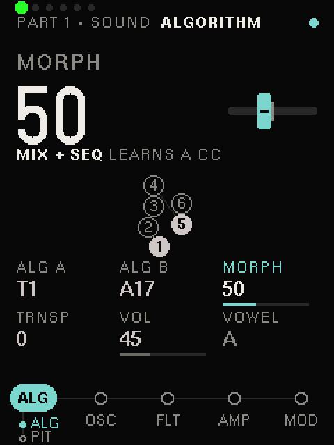
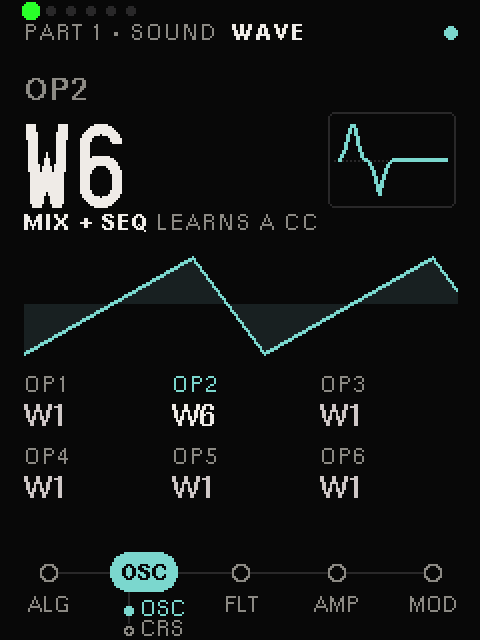
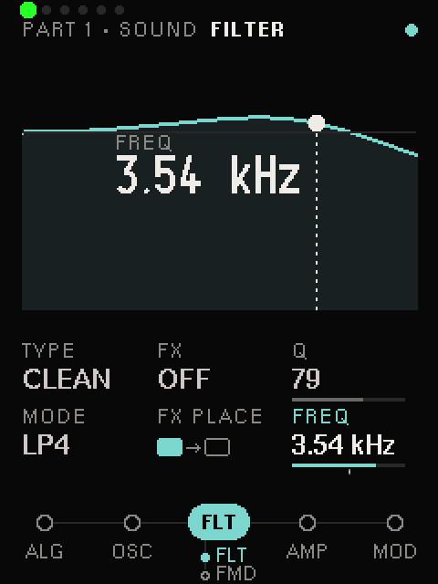
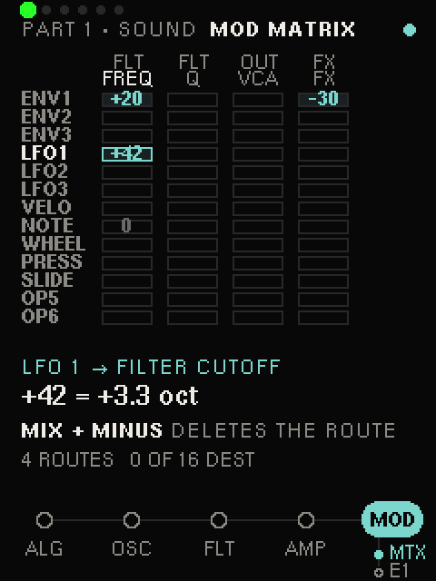
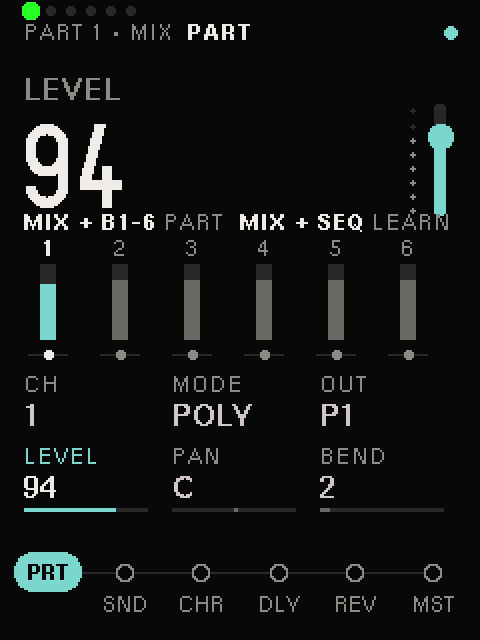
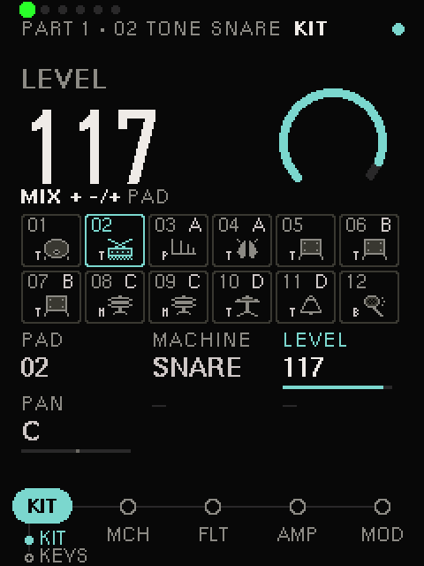

# Chimera

Alternative firmware for the [PreenFM3](https://github.com/Ixox/preenfm3)
(STM32H753): a multi-engine, multitimbral digital synthesizer with six Parts,
five synthesis engines and one screen-driven chain UI, written in Rust.

**Alpha.** Chimera is in alpha: Sounds, projects and the card layout can
still change between releases, and testers report what breaks.

## Screens

Rendered by the firmware's own renderer (`chimera-core`) at the display's
native 240×320, shown at 2×. Regenerate them with `just screens` after any
UI change.

| Algorithm | Operator waves | Filter |
|---|---|---|
|  |  |  |

| Mod matrix | Mixer · Part | Drum kit |
|---|---|---|
|  |  |  |

## Engines

Each Part plays one engine into a shared voice chain (drive, filter,
wavefolder, VCA and low-pass gate), then the master effects.

- **ALGO**: six-operator phase modulation, two algorithms morphed into one
  another (ADR 0022).
- **MODAL**: physical modelling, a modal resonator bank and Karplus-Strong
  strings, with Mutable Instruments' Rings and Elements as the reference
  (ADR 0004, 0032).
- **VA**: a two-oscillator virtual-analogue voice with MODE, SUB and
  STABILITY.
- **TAPE**: sample machines (ONESHOT, LOOP, TRON, STRETCH, TRANSWAVE, SCRUB,
  PING-PONG) playing sources from the SD card.
- **DRUM**: drum machines (kick, snare, tom, clap, cowbell, cymbal, hats and
  more) played from a KIT keymap.

The ORBIT build adds ORBIT, a generative polyrhythmic ring sequencer.
Design decisions live in `docs/adr/` (`docs/adr/README.md` is the index),
and the design history behind them (specs and implementation plans) in
`docs/superpowers/`.
Issue numbers in the source and the ADRs (`#123`) refer to the private
development tracker.

## How it is built

Chimera is written by AI agents directed by one engineer, who owns the
design, the specs and the testing.

## Building

Chimera needs **nightly Rust** (edition 2024): the engine uses
`#![feature(core_float_math)]` and `#![feature(optimize_attribute)]`, and the
firmware links with `-Z location-detail=none` (`.cargo/config.toml`).

```bash
rustup toolchain install nightly
rustup override set nightly       # in this directory
rustup target add thumbv7em-none-eabihf
rustup component add llvm-tools  # rust-objcopy, rust-objdump: bank 2's split, the stack check
cargo install cargo-binutils just
```

The desktop simulator needs ALSA's development files on Linux
(`libasound2-dev` and `pkg-config`). The browser editor and the site live in
[chimera-releases](https://github.com/joegiralt/chimera-releases) (`editor/`,
`site/`).

| Task | Command |
|---|---|
| Desktop simulator | `just desktop` |
| Firmware (`target/chimera.bin` and `.bk2`) | `just firmware` |
| Firmware with ORBIT | `just firmware-orbit` |
| Tests | `just test` |
| The full check | `just check` |

## Flashing

`just flash` builds the firmware and installs it with
`tools/chimera-usb.py update`: bank 2's `.bk2` goes onto the SD card over
USB, then the `.bin` goes to `0x08020000` over DFU. It needs `dfu-util` and
Python 3 (plus `pyserial` on macOS and Windows). The stock PreenFM3
bootloader (1.09) stays in place and is never written; `docs/recovery.md`
covers backing it up and restoring it.

## Licence

Copyright (C) 2026 Joe Giralt.

Chimera is free software: you can redistribute it and/or modify it under the
terms of the GNU General Public License as published by the Free Software
Foundation, either version 3 of the License, or (at your option) any later
version. See `LICENSE`. Code from others keeps its own notice;
`THIRD_PARTY.md` lists it.

## Contributions

Chimera takes no outside pull requests before 1.0: the design is still
moving, and every change is tested on the unit by one person. Issues are
welcome; a bug report helps most with the steps that trigger it and the
firmware version from SETTINGS › SYSTEM › ABOUT. Contributions after 1.0 will need a
contributor agreement.
