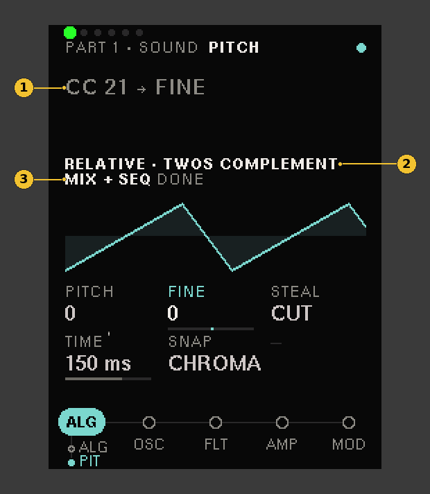
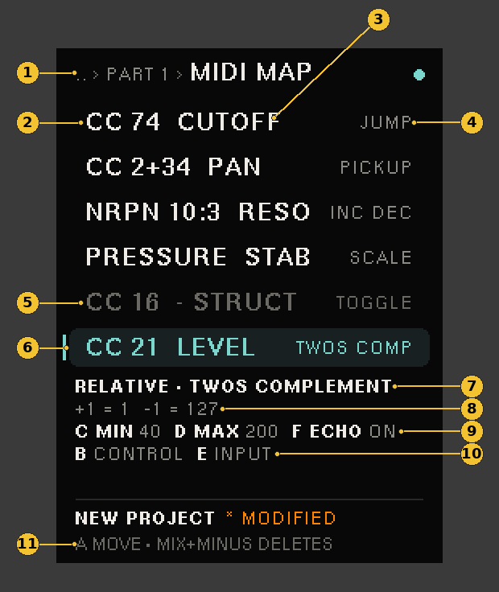
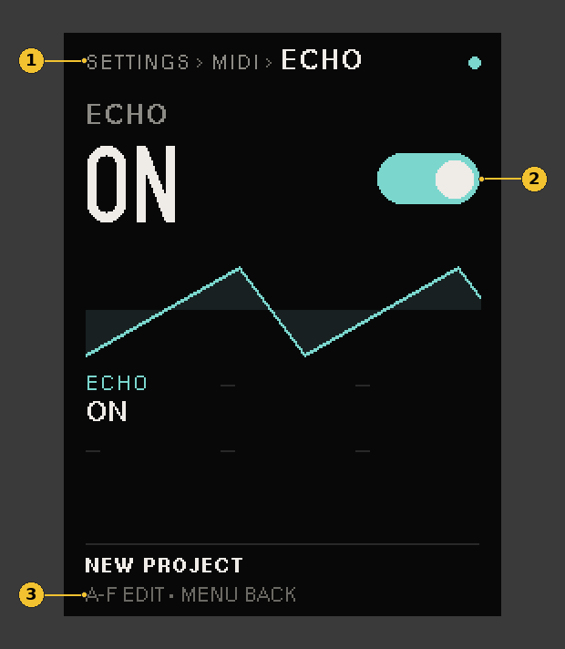

# MIDI control

Each Sound carries a MIDI map of up to 16 bindings. A binding ties one control on your controller to one cell of the Sound, on the Part's own MIDI channel. The map travels with the Sound: load the Sound on another Part and its knobs come with it, on that Part's channel. Parts that share a channel each follow their own map.

A binding's control can be:
- a **CC** (`CC 74`): a knob, fader, endless encoder or button;
- a **14-bit CC pair** (`CC 2+34`): a fine control that sends CC *n* and then CC *n*+32;
- an **NRPN** (`NRPN 10:3`): a sequencer lane or a high-resolution control;
- **PRESSURE**: channel aftertouch.

Every stored parameter also has a fixed NRPN address of its own, which works with no binding at all: see the [NRPN chart](../midi/nrpn-chart.md). A binding on the same NRPN number wins over it.

## The mod wheel and aftertouch in the matrix

The MOD MATRIX has two rows for your hands, after NOTE:

- **WHEEL** (MOD WHEEL in the readout): the mod wheel, CC 1, on the Part's channel. At rest it is 0, fully up it is 1.
- **PRESS** (PRESSURE in the readout): aftertouch. A keyboard with channel pressure moves every note on the Part's channel; one with poly pressure moves only the note whose key you press harder. Each note follows the higher of the two.

Route them like any other source: put the cursor on the WHEEL or PRESS row, under the column you want, and turn **E** for the amount. Both glide, so a fast wheel throw or a sudden squeeze never steps the sound. A new note starts with no poly pressure of its own; the channel's wheel and pressure carry on across notes, Sound loads and project loads.

The wheel and channel pressure still reach the MIDI map as well, so a binding on CC 1 or PRESSURE keeps working beside a route.

## Learn

1. Touch the cell you want to control (turn its encoder a notch).
2. Hold **MIX** and press **SEQ**. The value line reads `MOVE A KNOB · CUTOFF` (the cell's name).
3. Move the control on your controller. The binding is written at once, and Chimera listens on to tell what kind of control it is.
4. Turn it right, then left. Chimera guesses the kind and shows the guess in words.
5. Press **MIX + SEQ** again to keep the guess. A page change, a nav key or a turn of one of Chimera's own encoders also ends learn.

While learn listens, the control you are teaching moves nothing.

1. **The binding:** the control heard and the cell it drives (`CC 21 → FINE`).
2. **The guess**, in the value's place: `TURN IT RIGHT, THEN LEFT` until Chimera is sure, then the kind it heard (`RELATIVE · TWOS COMPLEMENT`).
3. **The hint:** `MIX + SEQ  DONE` once the guess is sure. Press it to finish.

The guesses are `ABSOLUTE` (a knob or fader), `RELATIVE · TWOS COMPLEMENT`, `RELATIVE · BINARY OFFSET` and the other relative encodings (an endless encoder), `BUTTON`, `14-BIT CC` and `INC DEC` (NRPN increment and decrement). A wrong guess is fixed on the MIDI MAP page with **E**.

Learn refuses, and says why, when a cell can't be mapped (`NOT MAPPABLE`), when the control comes in on another channel than the Part's (`CC 21 ON CH 3, PART ON CH 1`), when the CC is one Chimera keeps for itself (`CC 64 RESERVED`: the sustain pedal, bank select, data entry, NRPN and RPN select, and the channel mode messages) and when the map holds 16 bindings already (`MAP FULL`).

Learning a relative encoder or a 14-bit control turns its **ECHO** on, so a controller with LED rings shows the value. Knobs, faders, buttons and pressure learn with ECHO off.

## The MIDI MAP page

SETTINGS › PART › MIDI MAP shows the current Part's map, one binding a row. With no bindings it reads `NO CCS · MIX+SEQ ON A CELL`.

1. **Breadcrumb:** the Part whose map this is.
2. **The control:** `CC 74`, `CC 2+34`, `NRPN 10:3` or `PRESSURE`.
3. **The cell** it drives.
4. **How it moves**, in short: `JUMP`, `PICKUP`, `SCALE`, a relative encoding, `MOMENTARY`, `TOGGLE` or `INC DEC`.
5. **A dimmed row** drives a cell the Part's engine doesn't have (here a MODAL cell on an ALGO Sound). It waits, and works again when the Part plays that engine.
6. **The bar:** the selected binding. **A** moves it.
7. **The bar's binding, spelled out:** its kind in full words.
8. For a relative encoding, the bytes it sends for one step right and one step left, as controller manuals print them.
9. **C MIN** and **D MAX**: the part of the cell's range the control sweeps; MAX below MIN turns the control round. **F ECHO**: `ON` sends the cell's value back to the controller.
10. **B CONTROL**: the CC number. NRPN and PRESSURE controls are fixed: learn them again to change them (the line reads `RELEARN TO CHANGE`). **E INPUT**: how the control moves the cell.
11. **The hint:** `A MOVE · MIX+MINUS DELETES`. MIX + MINUS asks before it deletes the bar's binding.

**E INPUT** steps through the kinds the control can be:

| Row | Spelled out | For |
|---|---|---|
| `JUMP` | `ABSOLUTE · JUMPS TO THE KNOB` | A knob or fader. The cell glides to the knob's place at once. The default |
| `PICKUP` | `ABSOLUTE · WAITS TO PICK UP` | A knob or fader. Nothing moves until the knob reaches the cell's value |
| `SCALE` | `ABSOLUTE · SCALES TO MEET` | A knob or fader. The cell moves at once, scaled so knob and value meet at the ends |
| `TWOS COMP` | `RELATIVE · TWOS COMPLEMENT` | Endless encoders that send 1 for right and 127 for left |
| `OFFSET` | `RELATIVE · BINARY OFFSET` | 65 for right, 63 for left |
| `SIGNED` | `RELATIVE · SIGNED BIT` | 1 for right, 65 for left |
| `SIGNED 2` | `RELATIVE · SIGNED BIT 2` | 65 for right, 1 for left |
| `INC DEC` | `RELATIVE · NRPN`, then `INCREMENT AND DECREMENT` on the line below | NRPN only |
| `MOMENTARY` | `BUTTON · HELD IS MAX` | A button: held is MAX, let go is MIN |
| `TOGGLE` | `BUTTON · EACH PRESS FLIPS` | A button: each press flips between MIN and MAX |

A 14-bit pair and PRESSURE take JUMP, PICKUP or SCALE. A relative encoder turns the cell exactly as Chimera's own encoder does, a step a detent.

### Pickup

A binding on PICKUP waits for the knob. While it waits, the touched cell's value line says which way to move it.

1. **The touched cell**, FINE, bound to a PICKUP knob that sits below its value.
2. **The hint:** `MOVE THE KNOB UP TO PICK UP` (or `DOWN`). It clears as soon as the knob reaches the value; from then on the knob moves the cell.

The hint shows while HINTS is on at SETTINGS › PERSONALIZE › THEME.

## ECHO: values back to the controller

SETTINGS › MIDI CONFIG › ECHO (the last row of MIDI CONFIG, after SYNC, PORT CONFIG and CHANNELS) is the switch for everything Chimera sends from its MIDI OUT.

1. **Breadcrumb:** `SETTINGS › MIDI › ECHO`.
2. **ECHO:** `ON` (the default) or `OFF`. A turns it.
3. **The hint:** `A-F EDIT · MENU BACK`.

With ECHO on, each binding whose own ECHO is on sends its cell's value on the Part's channel, on its own control: a CC sends the value, a 14-bit pair both halves, an NRPN its full address and value, a button MIN or MAX as 0 or 127, and a relative encoder the absolute value on its CC, so its LED ring follows. Chimera sends a value when it changes, whatever changed it: Chimera's encoders, a Sound or project load, another binding, ORBIT. It holds a binding's echo for a quarter second after that binding's control last moved, so it never fights your hand. A Part change, a Sound load and a project load send the Part's values all at once.

When two Parts share a channel and bind the same control, the lower-numbered Part echoes.

With ECHO off, MIDI OUT stays silent.

If your setup sends Chimera's MIDI OUT back into its MIDI IN (a DAW track with MIDI thru on, an interface's soft thru, a controller that merges its input), ECHO can stay on: an echo that comes back within that quarter second is not taken as a turn, so a relative encoder's cell never walks.

## USB MIDI ports

Over USB, Chimera shows up as one MIDI device with these ports:
- **Chimera**, both ways: every channel, as on DIN. Clock, SysEx, the identity reply and ECHO use this port.
- **Chimera Part 1** to **Chimera Part 6**, into Chimera only: each plays its Part, whatever channel your DAW track sends on. Chimera moves the notes, CCs, bend and pressure to that Part's channel, so another Part on the same channel plays them too. Clock and SysEx on these ports are ignored.

## What else Chimera answers on DIN

When SETTINGS › ABOUT reads `NEEDS UPDATE`, Chimera ignores MIDI in, notes and clock too, until the update is installed: MIDI MAP reads `NEEDS UPDATE`, and **MIX + SEQ** says `NEEDS UPDATE` instead of starting learn.

- **Identity request** (`F0 7E 7F 06 01 F7`): Chimera answers with its identity and firmware version, while ECHO is on.
- **All Notes Off** (CC 123), and the Omni and Mono/Poly messages (CC 124–127): the notes of every Part on that channel are released. **All Sound Off** (CC 120) silences them, and **Reset All Controllers** (CC 121) resets the pedal, the bend, the mod wheel and pressure.
- **System Reset** (`FF`): every sound stops and every controller resets.
- **Active Sensing:** once a controller sends it, a pulled cable releases every held note within a third of a second, and the screen shows **DIN MIDI LOST**. A USB host that resets or sleeps while you hold a note or pedal does the same, with **USB MIDI LOST**.
- **RPN 0** sets the Part's BEND range, in semitones (0 to 24).
