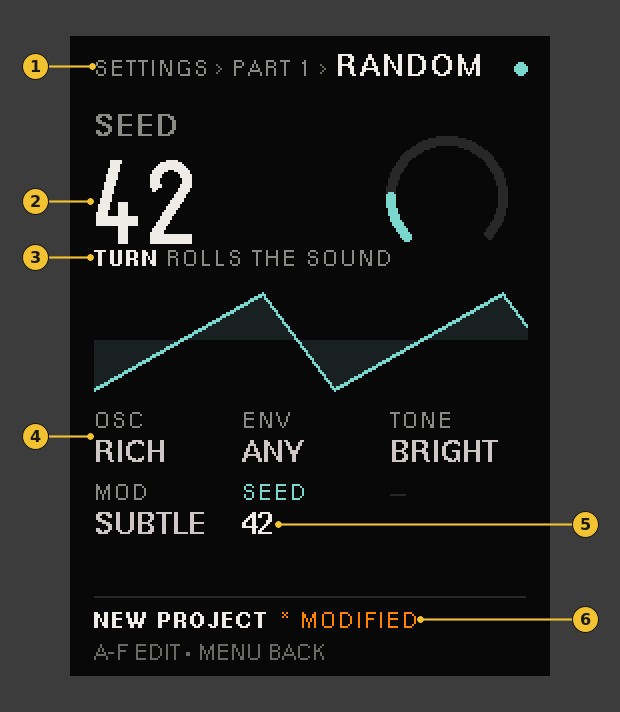

# Randomize

SETTINGS › PART › RANDOMIZE rolls a new Sound on the current Part. Each roll stays inside ranges that keep it musical:
- the note keeps its pitch;
- envelopes come from a family you pick;
- modulation is bounded;
- levels stay close to the engine's INIT.

A roll is never silent and never blasts. The same seed and amounts on the same Sound always roll the same result, so a Sound you like is easy to find again.

## The page

1. **Breadcrumb:** the Part being rolled.
2. **The focused cell's value.**
3. **The hint:** `TURN  ROLLS THE SOUND`. Every cell on this page rolls when you turn it.
4. **The amounts:**
   - **A OSC**: the oscillators or operators.
   - **B ENV**: the envelopes.
   - **C TONE**: brightness and depth.
   - **D MOD**: movement.

   `OFF` leaves that part of the Sound as it is.
5. **E SEED**, 0 to 255. Each detent rolls a new Sound. Turn back to a seed and its Sound comes back.
6. **The project reads `* MODIFIED`.** The Part's strip in SETTINGS › PART reads `* EDITED`.

## The amounts

| Cell | Values | What it rolls |
|---|---|---|
| OSC | `OFF` `PURE` `RICH` `WILD` | ALGO: the algorithm and each operator's ratio and wave. Carriers stay in octaves, so the note keeps its pitch. `WILD` can blend two algorithms with MORPH. VA: MODE, the waves and OSC 2's interval (octaves, then fifths and fourths), with detune, SUB, SHAPE and NOISE. MODAL: STRUCT and POS, and from `RICH` the MODEL. TAPE: nothing (the sample's pitch is its own) |
| ENV | `OFF` `PLUCK` `PAD` `ANY` | The amp envelope's family: `PLUCK` strikes and decays, `PAD` swells and holds, `ANY` can be either or between. ALGO: every operator's envelope. VA and TAPE: ENV 1. MODAL: DAMP, how long it rings |
| TONE | `OFF` `SOFT` `BRIGHT` `WILD` | The filter's CUTOFF and RESO (its TYPE and MODE stay). ALGO: the modulators' depth, FEEDBACK and VEL. MODAL: BRIGHT, BODY, COLOR and BURST |
| MOD | `OFF` `SUBTLE` `MOVING` `WILD` | LFO 2 and LFO 3's rate and shape, ENV 2, and how far ENV 2 and LFO 2 move CUTOFF and LFO 3 moves RESO. MODAL: the ensemble too |

Each amount draws on its own, so changing one leaves what the others rolled. On ALGO, an operator that OSC turns from a modulator into a carrier (or back) takes the envelope and depth of its new role.

A roll never touches:
- the Part's LEVEL, PITCH or sends;
- LFO 1 (the mod wheel's vibrato);
- a TAPE Sound's source, MODEL and place.

## Undo

A roll is an edit like a turn of any knob: the Sound glides to it while you play. To get the Part's saved Sound back, use SETTINGS › PART › RELOAD FROM PROJ. Nothing is saved until you save the Part (SAVE TO PROJ or SAVE TO LIBRARY).

With an incomplete update the five cells read `NEEDS UPDATE`, and turning them rolls nothing.
