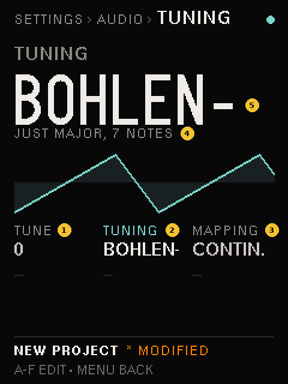

# Tuning

Each Part plays in a tuning of its own. Pick it on **SETTINGS › AUDIO ROUTING › TUNING**, cell B, **TUNING**: it sets the active Part's, as LIVE SNAP's cells do (pick another Part to set its own). Cell A, **TUNE**, still shifts the whole unit. A new note plays the tuning; a note already sounding keeps its pitch.



1. **TUNE**: the whole unit, in cents.
2. **TUNING**: the active Part's tuning.

| TUNING | What it plays |
|---|---|
| `12-TET` | Equal temperament, every semitone 100 cents. |
| `JUST` | 5-limit just intonation on C: pure thirds and fifths in C's keys. |
| `PYTHAG` | Pythagorean on C: pure fifths, bright wide thirds. |
| `MEANTONE` | Quarter-comma meantone: pure major thirds, a wolf fifth on G♯–E♭. |
| `WERCK` | Werckmeister III: a well temperament, every key playable, each its own colour. |
| `MTS` | The tuning a DAW or editor sends as MIDI Tuning Standard SysEx (below). |
| `TUNE1` – `TUNE8` | A Scala file from the card. |

C stays at its usual pitch in every named temperament, so a Part in `JUST` plays in tune with one in `12-TET` on C.

## Scala files

The card is inside the case, so a Scala file goes onto it over USB. With Chimera connected and on, run Chimera's `chimera-usb.py` tool (Python 3, Linux or macOS):

```
python3 chimera-usb.py tuning 3 pelog.scl
python3 chimera-usb.py tuning 3 pelog.scl pelog.kbm
```

The number, 1 to 8, picks the slot: the file lands as `TUNE3.SCL` (and `TUNE3.KBM`) in the card's **CHIMERA/TUNINGS** folder, and the TUNING choice `TUNE3` plays it. Sending a file to a slot again replaces it, and every Part on that slot plays the new one at once. A new `.scl` also clears the slot's old `.kbm`, so send the map after the scale, as the command does. Chimera only reads that folder; nothing else on the card changes.

- A `.scl` file holds the scale: up to 128 steps, in cents or as ratios. Thousands are in the Scala archive (huygens-fokker.org).
- A `.kbm` file of the same name (`TUNE1.KBM`), if present, maps keys to the scale's steps and sets the reference pitch. Without one, middle C plays the scale's first step at its usual pitch, and each key up plays the next step.
- Keys the map leaves out (`x`), or outside its range, play equal temperament.
- To take a file off the card again, name it: `python3 chimera-usb.py rm /CHIMERA/TUNINGS/TUNE3.SCL` (or `TUNE3.KBM`). Only `TUNE1` to `TUNE8` files can be removed this way. Every Part on that slot then plays `12-TET` (or, with only the `.kbm` gone, the scale on its own).
- A file is read when you pick its choice, when a project using it loads, and when a new one is sent to or removed from its slot. If it is missing or can't be read, the Part plays `12-TET` and the screen says why, such as `TUNE3.SCL NOT FOUND` or `TUNE3.SCL NOT SCALA`. Files up to 4 KB are read.

The project keeps the choice, not the file: change `TUNE1.SCL` on the card and every project on `TUNE1` plays the new one.

## MIDI Tuning Standard

A Part on `MTS` plays the tuning received over MIDI, DIN or USB. Chimera takes:
- **single-note tuning changes** (real-time, and the bank form);
- **bulk tuning dumps** (all 128 keys);
- **scale/octave tuning**, one-byte and two-byte (each pitch class in every octave).

Messages for device 7F (all) or 0 are taken. Every Part on `MTS` follows one MTS tuning; the tuning program and channel bits in a message are ignored. A received tuning lasts until the unit is turned off: it isn't saved with the project.
